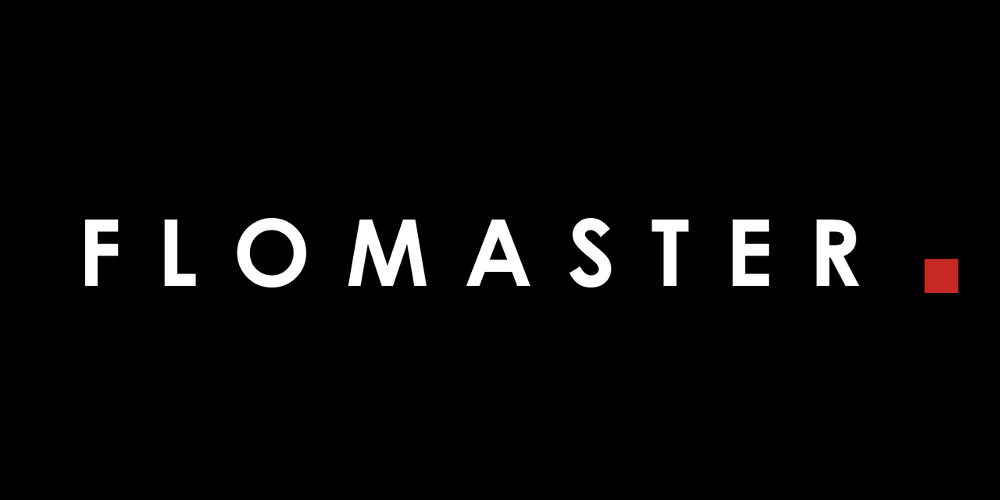
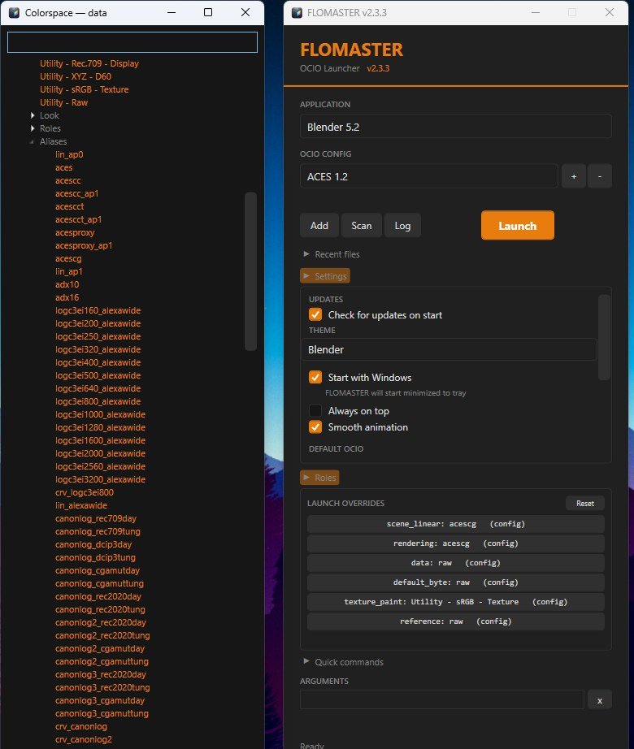
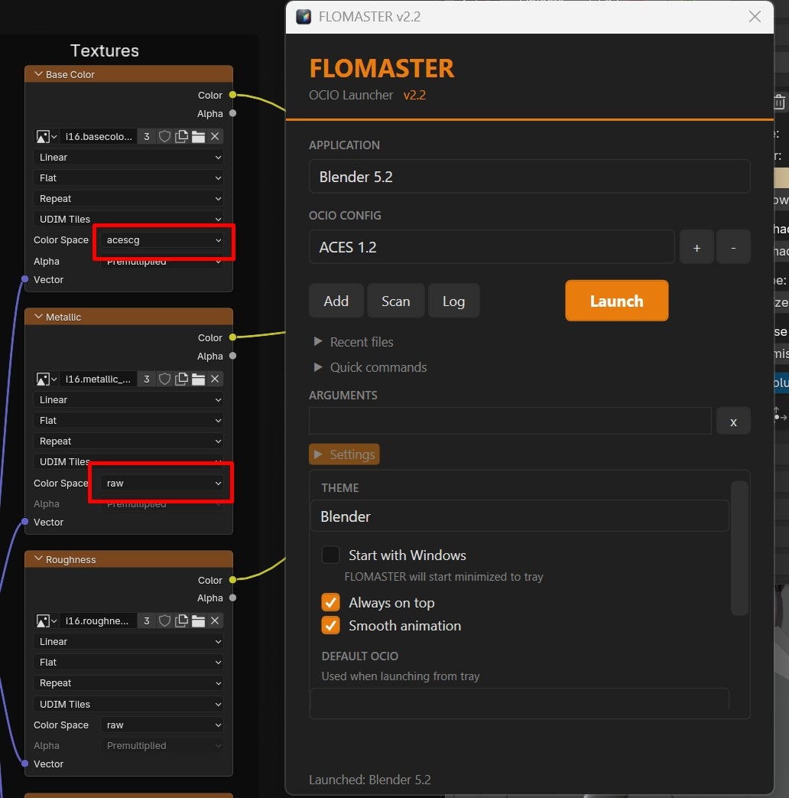
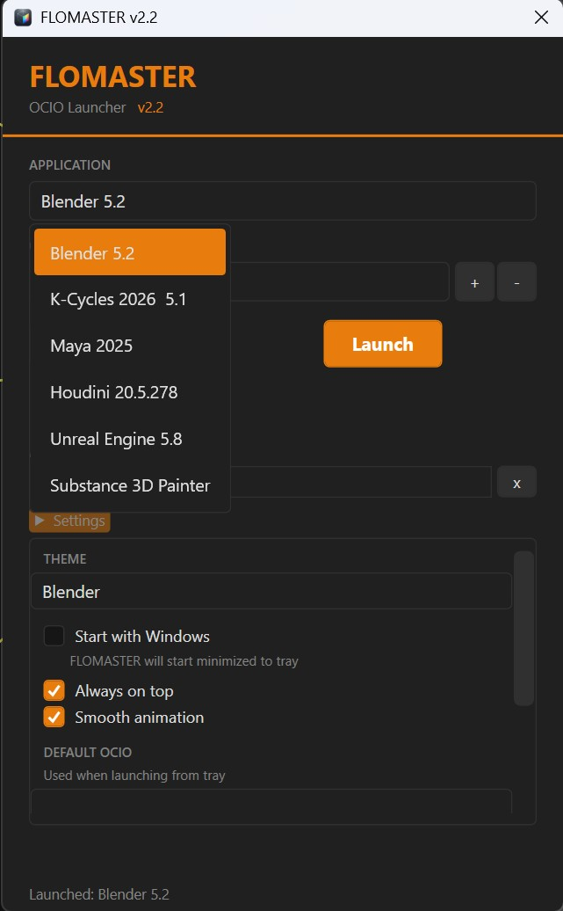
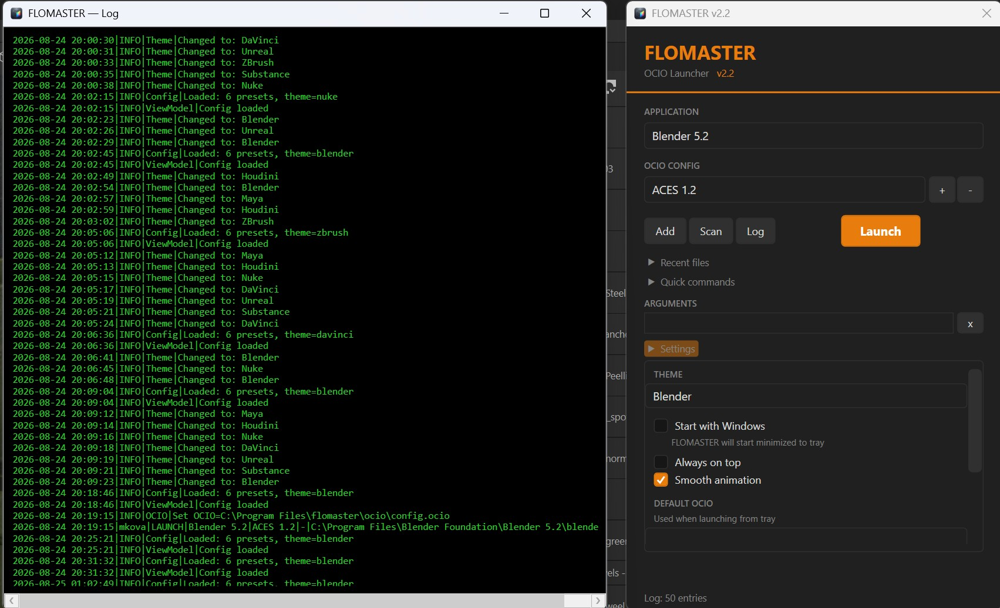

# FLOMASTER



[](https://github.com/abyrvalg379/FLOMASTER/releases/latest)
[](https://github.com/abyrvalg379/FLOMASTER/blob/main/README.ru.md#быстрый-старт)
[](test/smoke_flomaster.py)

**OCIO-лаунчер** — единая точка запуска DCC-приложений с поддержкой кастомного цветового пространства ACES 1.2.

*English documentation: [README.md](README.md)*

---

## Быстрый старт

1. Скачай последний релиз со страницы [Releases](https://github.com/abyrvalg379/FLOMASTER/releases/latest)
2. Распакуй архив
3. Запусти `FLOMASTER.exe`
4. Лаунчер автоматически найдёт установленные DCC-приложения

### Требования

- Windows 10/11
- .NET 8 Desktop Runtime (входит в self-contained сборку — устанавливать ничего не нужно)

---

## Скриншоты



| | |
|:---:|:---:|
|  |  |



---

## Что нового в v2.6.2

- **Авто-английская раскладка (Houdini, Maya)** — новая опция в Settings против вечной боли: в русской раскладке хоткеи DCC не работают (Houdini и Maya привязывают их к символам, а не к физическим клавишам). Включив опцию, получаете фоновый сторож (`DccEnLayout.exe`, ~9 КБ, вшит в лаунчер): при переходе фокуса на окно Houdini/Maya раскладка сама становится английской за секунду, без действий пользователя. Остальные программы не трогаются; внутри DCC Alt+Shift по-прежнему даёт русский для заметок и держится, пока не уйдёте из окна. Сторож разворачивается в `%LOCALAPPDATA%\FLOMASTER`, стартует из HKCU-автозагрузки и живёт независимо от лаунчера; standalone-установка HoudiniEnLayout подхватывается и тихо замещается
- Опция выключена по умолчанию (публичный релиз); преференс едет в Settings Export, старые экспорты поле не несут и выбор не переворачивают

Смоук 22/22, юнит-тесты 140.

### [v2.6.1](https://github.com/abyrvalg379/FLOMASTER/releases/tag/v2.6.1) — NukeX, аргументы пресетов, фиксы Nuke

- **Поддержка NukeX** — с Nuke 16 редакции Nuke, NukeX и Studio собраны в один бинарник, и сканеры, ищущие отдельный NukeX-exe, не находят ничего. Автоскан теперь добавляет вторую плитку **NukeX**: тот же exe с флагом `--nukex` и родной иконкой NukeX (ровно как ярлык самой Foundry на рабочем столе). Легаси-установки (≤ Nuke 15) находятся по собственному exe
- **Аргументы на уровне пресета** — пресет может нести вшитые аргументы; они всегда едут впереди ваших — на плитках, quick-командах, маршрутизации файлов, `--launch` из командной строки и в шорткатах, созданных FLOMASTER. Профили по-прежнему хранят только ваши аргументы. Вшитые видны прямо в подзаголовке плитки (`Nuke17.1.exe · --nukex`) — близнецы различимы и ищутся поиском
- **Фиксы Nuke** — quick-команда рендера диапазона реально рендерит (`-x "file" -F 1-100`), тултип плитки объясняет разовый перевод Project Settings → Color → OCIO, а плитка зовётся «Nuke 17.1v2» вместо заикающегося «Nuke Nuke17.1v2»

Мануалы (RU + EN, DOCX/PDF) — в активах релиза. Смоук 22/22, юнит-тесты 140.

### [v2.6.0](https://github.com/abyrvalg379/FLOMASTER/releases/tag/v2.6.0) — запуск без OCIO, папка-синк, баннер обновления с заметками релиза
Запуск без OCIO (чип NO OCIO), папка-синк настроек, апгрейднутый баннер обновления с панелью заметок релиза, переключение дашборд ↔ виджет, цикл сортировки Apps и анимация шторок.

### [v2.5.8](https://github.com/abyrvalg379/FLOMASTER/releases/tag/v2.5.8) — сортировка проектов, баннер обновления
Переключатели сортировки списка проектов (A-Z / Date / Apps) и явный баннер готового обновления в обоих окнах.

### [v2.5.7](https://github.com/abyrvalg379/FLOMASTER/releases/tag/v2.5.7) — обновления везут конфиг
Автообновление скачивает полный пакет (exe + OCIO-конфиг), дефолты проектов Painter'а следуют регламенту, пути конфигов больше не протухают.

### [v2.5.6](https://github.com/abyrvalg379/FLOMASTER/releases/tag/v2.5.6) — самолечение
Запуски без скрытого админа после обновлений; потерянные пути OCIO-конфигов чинятся сами при старте.

### [v2.5.5](https://github.com/abyrvalg379/FLOMASTER/releases/tag/v2.5.5) — эпоха дашборда
Дашборд стал нести весь функционал лаунчера: шторки ролей и лога, запуск с командой с плитки, чипы запущенных приложений, клавиатурная навигация, чистый сканер, компактная сетка плиток 2×N.

### [v2.5](https://github.com/abyrvalg379/FLOMASTER/releases/tag/v2.5) — полноэкранный дашборд
Полноэкранный дашборд (`Ctrl+Alt+F`): конфиг-чипы, плитки приложений с иконками exe, проекты, профили, OCIO-роли, recent и быстрые настройки — поверх всего, с переносом между мониторами. Маршрутизация файлов проектов (.spp в Painter, .blend в Blender, .hip в Houdini). PerMonitorV2.

### [v2.4.2](https://github.com/abyrvalg379/FLOMASTER/releases/tag/v2.4.2) — маршрутизация файлов проектов
.spp открывается в Substance Painter, .blend в Blender, .hip в Houdini независимо от выбранного приложения. Работает в панели Projects, Recent и drag & drop.

### [v2.4.1](https://github.com/abyrvalg379/FLOMASTER/releases/tag/v2.4.1) — командная строка + мультистанционность
- **CLI** — `--launch "Профиль" [--project файл]` и `--list-profiles`: без окна, коды возврата, то же окружение, что у ручного запуска
- **Мультистанционность** — экспорт/импорт настроек файлом; сканер читает реестр и манифесты Epic
- **Глобальный хоткей, тематизированная шапка, панель Projects** — укажите папки проектов и открывайте файлы без проводника

### [v2.3.5](https://github.com/abyrvalg379/FLOMASTER/releases/tag/v2.3.5) — прототип панели Projects + починенный Recent
Первый вариант браузера проектов; починен клик по recent-файлам.

### [v2.3.4](https://github.com/abyrvalg379/FLOMASTER/releases/tag/v2.3.4) — профили запуска
Именованные снимки «приложение + OCIO + аргументы» с быстрым запуском из трея; панели переупорядочены.

### [v2.3.3](https://github.com/abyrvalg379/FLOMASTER/releases/tag/v2.3.3) — пикер ролей OCIO + автообновление
Переопределения ролей на пресет с пикером-деревом; проверка обновлений на старте. Канонический конфиг не трогается.

### [v2.3.2](https://github.com/abyrvalg379/FLOMASTER/releases/tag/v2.3.2) — валидация OCIO-конфига
Ключевые роли показываются и валидируются — предупреждения прямо в UI и логе.

### [v2.3.1](https://github.com/abyrvalg379/FLOMASTER/releases/tag/v2.3.1) — фиксы трея
Меню трея обновляется с пресетами; отсутствующий exe предупреждает вместо тихого бездействия.

### [v2.3](https://github.com/abyrvalg379/FLOMASTER/releases/tag/v2.3) — пайплайн-корректные дефолты
Явные ACES-роли в бандл-конфиге: 8-бит грузится как `raw`, float (EXR) как `acescg`.

<details>
<summary><b>Новое в v2.2</b></summary>

- **7 цветовых тем** — цвета Houdini и Nuke сняты пипеткой с реальных интерфейсов
- **Полностью темизированный интерфейс** — чекбоксы, скроллбар и выпадающие меню следуют выбранной теме, везде скруглённые углы
- **Плавная анимация панелей** — нативная WPF-анимация с easing (отключается в настройках)
- **Расширенный drag & drop** — добавлены `.mb`, `.hipl`, `.hipnc`
- **Окно открывается в правом верхнем углу** экрана
- Внутри — MVVM-архитектура

</details>

---

## Командная строка

Запуск без окна — профиль разворачивается в приложение + OCIO-конфиг + аргументы, так что батники и фермы получают ту же среду, что и ручной запуск:

```
FLOMASTER.exe --list-profiles
FLOMASTER.exe --launch "Проект А" 
FLOMASTER.exe --launch "Проект А" --project "D:\projects\A\shot_042.blend"
```

`--project` добавляет файл к аргументам профиля (или подставляется вместо плейсхолдера `{file}`, если он есть в профиле). Коды возврата: `0` — запущено, `2` — не найден профиль/пресет/файл, `1` — ошибка запуска — удобно для скриптов.

---

## Возможности

### Цветовые темы DCC
7 схем, вдохновлённых софтом, который они представляют:

| Тема | Акцент | База |
|------|--------|------|
| **Blender** | Оранжевый | Тёмный графит |
| **Maya** | Циановый | Сине-серая |
| **Houdini** | Красно-оранжевый | Тёмная, снята с интерфейса Houdini |
| **Nuke** | Светло-серый | Графит — монохром, как сам Nuke |
| **DaVinci** | Розово-красный | Фиолетово-синяя |
| **Unreal** | Синий | Холодный графит |
| **Substance** | Зелёный | Чёрная |

Каждый контрол следует теме: кнопки, чекбоксы, скроллбар, выпадающие меню и подсветка кнопки запуска.

### Автоскан
Находит: Blender, K-Cycles, Maya, Houdini, Nuke, DaVinci Resolve, Unreal Engine, Substance Painter. Свои папки сканирования добавляются в настройках.

### Быстрые команды
Раскрывающееся меню с аргументами запуска для каждого приложения.

### Недавние файлы
Недавно открытые файлы: `.blend`, `.spp`, `.ma`, `.mb`, `.hip`, `.hipl`, `.hipnc`, `.nk`

### Drag & Drop
- `.exe` → создать пресет (спросит имя)
- Файл проекта → открыть выбранным приложением с применённым OCIO

### Контекстное меню
ПКМ по файлу → «Open in FLOMASTER»

### Системный трей
Сворачивается в трей, быстрый запуск с OCIO-конфигом по умолчанию.

### Логирование
Все запуски логируются: время, пользователь, приложение, OCIO-конфиг, коды выхода. Просмотр — кнопкой Log.

### Настройки
- **Тема** — выбор цветовой темы
- **Запуск с Windows** — автостарт, свёрнутым в трей
- **Поверх всех окон** — окно выше остальных
- **Плавная анимация** — включить/отключить анимацию панелей
- **OCIO по умолчанию** — конфиг для запусков из трея
- **Папки сканирования** — свои папки для автоскана
- **Ярлыки** — в меню «Пуск» и на рабочем столе

---

## Структура

```
FLOMASTER/
├── FLOMASTER.exe             ← Приложение (self-contained)
├── flomaster.ico             ← Иконка
├── flomaster_logo.png        ← Логотип
├── LICENSE.txt               ← Лицензия MIT
├── README.md                 ← Английский README
├── README.ru.md              ← Этот файл
└── ocio/                     ← Конфиг ACES 1.2
    ├── config.ocio
    └── luts/
```

Пользовательские данные (создаются в `%APPDATA%\FLOMASTER\`):
```
├── launcher_config.json      ← Настройки
└── flomaster.log             ← Лог запусков
```

---

## Поддержка OCIO

| Приложение | Поддержка |
|------------|-----------|
| Blender | Нативно (переменная окружения OCIO) |
| Maya | Нативно (переменная окружения OCIO) |
| Houdini | Нативно (переменная окружения OCIO) |
| Nuke | Нативно (переменная окружения OCIO) |
| DaVinci Resolve | Нативно (переменная окружения OCIO) |
| Substance Painter | Нативно (переменная окружения OCIO) |
| Unreal Engine | Через аргумент `-ocio=` (env-переменную не читает) |

---

## Сборка из исходников

```bash
cd FLOMASTER_CS
dotnet publish -c Release -r win-x64 --self-contained true -p:PublishSingleFile=true -p:IncludeNativeLibrariesForSelfExtract=true
```

Требуется .NET 8 SDK. Результат — один self-contained exe ~155 МБ.

---

## Лицензия

MIT — см. [LICENSE.txt](LICENSE.txt). Сторонние лицензии: [NOTICE.md](NOTICE.md)

OCIO-конфиг — лицензия Academy of Motion Picture Arts and Sciences. Подробности в ocio/LICENSE.md.

---

## Связанные инструменты

| Инструмент | Описание |
|------------|----------|
| [STUKACH](https://github.com/abyrvalg379/STUKACH) | Проверка ассетов пайплайна в Blender |
| [LAMPOCHKA](https://github.com/abyrvalg379/LAMPOCHKA) | Менеджер света в сцене |
| [Switch_UDIM](https://github.com/abyrvalg379/Switch_UDIM) | Переключатель текстур Single ↔ UDIM |
| [FILTER](https://github.com/abyrvalg379/FILTER) | Видимость/выделение по типу, имени, коллекции + массовое управление модификаторами |
